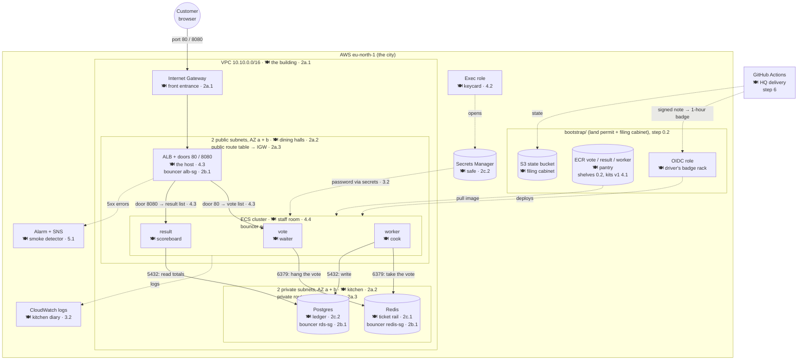

# Steps — Final Project

The steps of the final project, in order. Do not move on before the current step works. Debugging Terraform through a pipeline is slow, so **run each infrastructure step on your machine first**.

**How to read this file:**
1. [The map](#the-map): where you are. Click a step to jump to it.
2. Each step: 🍽️ what it is in the restaurant, **Parts** numbered `<step>.<part>` (e.g. 4.2) with ✅/⬜, 📜 which contracts it fulfils, 🛠️ what to do, ⚠️ pitfalls.
3. 📘 **Lessons**: a step with new ideas ends with a lesson (click to open): the idea, check commands, "if it fails", check questions with answers.
4. A contract ID such as [S3](#S3) is a link to the [contracts table](#contracts-table) at the end, which says in one line what it means. The full wording is in [README.md](README.md).

## The map

We build a restaurant where people vote and see the totals. Customers enter through the **front entrance** (Internet Gateway) and meet the **host** (ALB). The host sends them to the **waiter** (`vote`), who hangs each order on the **ticket rail** (Redis). The **cook** (`worker`) takes the tickets and writes them in the **ledger** (Postgres), and the **scoreboard** (`result`) shows the totals. The full mapping is in [FAQ.md](FAQ.md).

| Step | In the restaurant | In the project | Contracts | Lessons | Status |
|---|---|---|---|---|---|
| [0](#step-0--bootstrap) | Land permit + filing cabinet | `bootstrap/`: state bucket, ECR, OIDC role | — | — | ✅ |
| [1](#step-1--run-the-app-locally) | Taste the dishes at home | Run the app locally with Docker | — | — | ✅ |
| [2a](#step-2a--the-building-and-the-signs) | Building, entrance, wings, rooms, signs | VPC, IGW, 2 AZs, 4 subnets, 2 route tables + 4 associations | [N1](#N1)–[N4](#N4) | [📘 2a](#lesson-2a) | ✅ applied |
| [2b](#step-2b--the-bouncers) | Bouncers at each door | 4 security groups (alb, ecs, redis, rds) | [N5](#N5) | [📘 2b](#lesson-2b) | ✅ applied |
| [2c](#step-2c--ticket-rail-ledger-and-safe-) | Ticket rail, ledger, safe with the lock code 💰 | Redis, Postgres, `random_password` → Secrets Manager | [D1](#D1)–[D3](#D3) | [📘 2c](#lesson-2c) | ✅ applied 💰 |
| [3](#step-3--the-service-module) | A standard station kit | `modules/service`: task definition + ECS service + logs | [S2](#S2), [S3](#S3), [S5](#S5), [S6](#S6) | [📘 3](#lesson-3) | ✅ |
| [4](#step-4--open-the-restaurant) | Pantry stocked, the host, 3 workers on shift | Images in ECR, ALB + target groups, vote/result/worker | [S1](#S1), [S4](#S4), [S7](#S7), [D4](#D4), [L1](#L1)–[L3](#L3) | — | ⬜ **now** (4.4b) |
| [5](#step-5--operations-and-the-second-building) | Smoke detector, name tags, a second building | Alarm + SNS, outputs, validations, `default_tags`, `prod.tfvars` | [O1](#O1), [O2](#O2), [E1](#E1)–[E5](#E5), [C1](#C1)–[C5](#C5) | — | ⬜ |
| [6](#step-6--the-pipeline) | HQ delivery service + head chef's tasting | GitHub Actions pipeline, OIDC, prod approval | [P1](#P1)–[P11](#P11) | — | ⬜ |
| [7](#step-7--prove-everything) | Health inspection | Prove the 4 real tests, incl. a failed deploy that rolls back | [F1](#F1)–[F4](#F4) | — | ⬜ |
| [8](#step-8--cleanup) | Demolition, then return the permit | `destroy` prod, dev, then `bootstrap/` | [F5](#F5) | — | ⬜ |

### The diagram: where everything sits and how it connects

Each box shows the AWS resource, its restaurant name, and the part where it is created (for example `2c.1`). **Solid lines** are the path of a vote. **Dashed lines** are support: images, the password, logs, alarms, the pipeline. (It renders on GitHub. In VS Code, install the extension "Markdown Preview Mermaid Support" and open the preview with `Ctrl+Shift+V`.)



**Daily rule:** from step 2c on, AWS bills by the hour (about 3 USD/day). At the end of each day destroy `infra/` (`tfm` → 15). Never destroy `bootstrap/` before step 8.

---

## Step 0 — Bootstrap

> 🍽️ **The land permit and the filing cabinet.** Set up once, before any building.

**Parts:**
- ✅ **0.1 A separate GitHub repo** (`fptf-voting-app`, public)\
  🍽️ HQ's office where the blueprints are kept. 🛠️ The repo root holds `bootstrap/`, `infra/`, `services/`, `.github/`.
- ✅ **0.2 `bootstrap/` apply**\
  🍽️ The land permit, the filing cabinet, the pantry shelves and the driver's badge rack. 🛠️ S3 state bucket, 3 ECR repos, OIDC provider + role.
- ✅ **0.3 The 3 repository variables**\
  🍽️ HQ's address card for the driver. 🛠️ `AWS_ROLE_ARN`, `TF_STATE_BUCKET`, `NAME_PREFIX` under repo → Settings → Variables.
- ✅ **0.4 The 2 GitHub Environments**\
  🍽️ The head chef who must taste before the real restaurant. 🛠️ `dev` (plain) and `prod` with a required reviewer.

🛠️ Follow "Setup (once)" in [README.md](README.md#setup-once): a separate GitHub repo, `bootstrap/` apply (state bucket, ECR repositories, OIDC role), the 3 repository variables and the 2 GitHub Environments. Keep `bootstrap/` and its `terraform.tfstate`; you need them for the cleanup.

## Step 1 — Run the app locally

> 🍽️ **Taste the dishes at home** before opening the restaurant: see what each worker needs (ports, Redis, Postgres, env vars).

**Parts:**
- ✅ **1.1 Start the app with Docker**\
  🍽️ Cook every dish at home. 🛠️ Docker runs vote, result, worker, Redis and Postgres locally.
- ✅ **1.2 Vote and see the result change**\
  🍽️ Order and watch the scoreboard. 🛠️ Proves the whole path vote → Redis → worker → Postgres → result.
- ✅ **1.3 Remove the containers**\
  🍽️ Clean the home kitchen. 🛠️ Stop and remove the local containers.

🛠️ Follow "Run it on your machine" in [services/README.md](services/README.md). Vote a few times and see the result change. Then remove the containers. You now know what each service needs.

## Step 2 — The network and the data

Start with `infra/` for **dev only**, on your machine. The files of contract [C1](#C1) already exist and are empty (one comment line says what belongs in each). **Put each block in the right file as you write it.** It is much easier than writing one big file and splitting it later.

Connect `infra/` to the state once (or `tfm` → 11), then plan and apply after each part (`tfm` → 13 / 14):

```bash
cd infra
terraform init \
  -backend-config="bucket=<state_bucket>" \
  -backend-config="key=voting-app/dev/terraform.tfstate" \
  -backend-config="region=eu-north-1" \
  -backend-config="use_lockfile=true"
terraform apply -var-file=envs/dev.tfvars -var="name_prefix=<name>" -var="image_tag=none"
```

### Step 2a — The building and the signs

> 🍽️ **Build the building** (VPC), the **front entrance** (IGW), **two wings** (AZs), a **dining hall** and a **kitchen** in each wing (public / private subnets), and the **direction signs** (route tables) hung in each room (associations).

**Parts:**
- ✅ **2a.1 VPC + Internet Gateway**\
  🍽️ The building and its front entrance. 🛠️ `aws_vpc` (10.10.0.0/16, DNS on) and `aws_internet_gateway`.
- ✅ **2a.2 4 subnets, computed**\
  🍽️ A dining hall and a kitchen in each of the 2 wings. 🛠️ `data` AZs + `slice`, `for_each`, `cidrsubnet` → 2 public, 2 private /24.
- ✅ **2a.3 2 route tables + 4 associations** (plan: 12 to add)\
  🍽️ Direction signs, hung in each room. 🛠️ Public: `0.0.0.0/0` → IGW; private: no internet; `for_each` over the subnets.
- ✅ **2a.4 First apply + check + commit**\
  🍽️ The builders build it; the inventory notebook records it. 🛠️ `apply` (12 added), `state list`, `git push`.

📜 Contracts: [N1](#N1) [N2](#N2) [N3](#N3) [N4](#N4). File: `network.tf`. Free.

⚠️ Pitfalls:
- **A subnet is public only because of its route table.** A subnet with a route to the Internet Gateway is public, one without it is private. Forgetting the `aws_route_table_association` leaves the subnet on the VPC's main route table (no internet), and the ALB or the tasks cannot be reached.
- **Check the network before you build on it.** `terraform plan` should show 1 VPC, 1 gateway, 4 subnets, 2 route tables and 4 associations. In the console (VPC → Subnets) each subnet shows the zone and the route table you expect.
- **Two availability zones are mandatory** for the ALB, the RDS subnet group and the ElastiCache subnet group.
- **`cidrsubnet(var.vpc_cidr, 8, n)`** cuts a /24 out of a /16. Use different numbers for public and private (for example 0 and 1, and 10 and 11), or two subnets get the same range.
- **The name of a VPC or a subnet is a tag** (`Name`), not an argument. Without the tag the console shows only ids.

<a id="lesson-2a"></a>
<details><summary><b>📘 Lesson 2a: subnets, route tables, first apply</b> (click to open)</summary>

**How every lesson works:** Idea → code (in the file named, with `# Map` comments) → command → expected result → check question. Do one part at a time. `PLAN` = `tfm` → 13, `APPLY` = `tfm` → 14.

**Idea: never type zones or addresses (N2).** Another region has other zone names, and prod uses `10.20.0.0/16`. So ask AWS, and calculate.
- **`data`** reads something that exists; a `resource` creates. `data "aws_availability_zones"` → `["eu-north-1a", "eu-north-1b", "eu-north-1c"]`, and `slice(list, 0, 2)` keeps the first 2.
- **`cidrsubnet`** is an address calculator:
  ```
  cidrsubnet("10.10.0.0/16", 8, 0)   →  "10.10.0.0/24"
  cidrsubnet("10.10.0.0/16", 8, 10)  →  "10.10.10.0/24"
                              │  └── which slice: becomes the 3rd number
                              └───── add 8 to /16 → /24
  ```
- **`{ for i, az in local.azs : az => i }`** makes the map `{ "eu-north-1a" = 0, "eu-north-1b" = 1 }`: the key is the zone, the value is a number for `cidrsubnet` (private adds 10).
- `azs` lives in `network.tf`, not `locals.tf`: a local used by one file stays next to it (C3).

**Idea: route tables (N3).** A subnet is "public" **only** because its route table points to the IGW; the name doesn't matter. A route table does nothing until it's **associated** with each subnet (4 subnets → 4 associations). `for_each = aws_subnet.public` loops over another resource's copies; `each.value.id` is each subnet's ID.
```
public subnets  → public route table  → 0.0.0.0/0 → IGW → internet
private subnets → private route table → (only inside the VPC)
```

**Expected:** after the subnets `Plan: 6 to add`; after the route tables `Plan: 12 to add`; `APPLY` → `Resources: 12 added`. The network is free.

**Check it:**
```bash
terraform state list            # 12 lines + 1 data. line
aws ec2 describe-subnets --region eu-north-1 \
  --filters "Name=tag:Name,Values=fptf-dev-*" \
  --query 'Subnets[].[Tags[?Key==`Name`]|[0].Value, AvailabilityZone, CidrBlock]' --output table
```
4 subnets: 2 in `eu-north-1a`, 2 in `eu-north-1b`. Console: VPC → Subnets → Route table tab: public shows `igw-...`, private only `local`.

> **If it fails**
> - `Reference to undeclared resource`: check the spelling of `data.aws_availability_zones.available`.
> - `Invalid function argument` on `cidrsubnet`: you wrote `each.key` (text) instead of `each.value` (a number).
> - `Unsupported attribute "id"`: you wrote `each.key.id`; it's `each.value.id`.
> - Only 10 to add: one association block is missing.

**Check questions** (answers under each):
1. In prod, `vpc_cidr = "10.20.0.0/16"`. Which address does the **private** subnet in zone B get?\
   *Answer:* `cidrsubnet("10.20.0.0/16", 8, 1 + 10)` = **`10.20.11.0/24`**. Zone B is position 1, and private adds 10.
2. What would happen to the ALB if you forgot `aws_route_table_association.public`?\
   *Answer:* the public subnets stay on the VPC's main route table, with no route to the IGW. The ALB has no internet path, and nobody can reach the site.
3. Run `PLAN` right after the apply. What does it say, and why?\
   *Answer:* `No changes`. Everything in the code exists in AWS and is recorded in the state.

</details>


### Step 2b — The bouncers

> 🍽️ **A bouncer at each door, with a guest list.** The host's door is open to the street; the workers let in only the host; the ticket rail and the ledger let in only the workers.

**Parts:**
- ✅ **2b.1 4 security groups** (plan: 4 to add)\
  🍽️ A bouncer with a guest list at each door. 🛠️ alb 80/8080 from anyone; ecs 80 from alb-sg; redis 6379 and rds 5432 from ecs-sg.
- ✅ **2b.2 Apply + commit**\
  🍽️ The bouncers are hired (free until they guard something). 🛠️ `apply` (4 added), `git push`.

📜 Contract: [N5](#N5). File: `network.tf`. Free.

⚠️ Pitfalls:
- **Every security group needs the `vpc_id` of your VPC.** Without it, it is created in the default VPC and cannot be attached to your resources.
- **Security group names must not start with `sg-`**, and a `description` is required.
- **A security group with no `egress` block** loses the default "allow all outbound" rule. This is important for `ecs-sg` (step 4). Redis and RDS do not need outbound.

<a id="lesson-2b"></a>
<details><summary><b>📘 Lesson 2b: security groups</b> (click to open)</summary>

**Idea:** a security group is a bouncer: who may come in (**ingress**) and where things may go out (**egress**). Code: end of `infra/network.tf`.

| Bouncer | Who may come in | Out? |
|---|---|---|
| `alb-sg` | **Anyone** on 80 and 8080 | Yes, to reach the app |
| `ecs-sg` | Port 80, **only from `alb-sg`** | Yes: Redis, the DB, ECR, logs |
| `redis-sg` | 6379, **only from `ecs-sg`** | Not needed |
| `rds-sg` | 5432, **only from `ecs-sg`** | Not needed |

A chain: internet → ALB → app → databases; nobody skips a link. **The trick:** allow "whoever wears badge `ecs-sg`" with `security_groups = [aws_security_group.ecs.id]` instead of `cidr_blocks`. `protocol = "-1"` with ports 0–0 means "everything".

**Expected:** `Plan: 4 to add` (the network isn't touched), then `APPLY` → `4 added`. Free.

**Check it:**
```bash
VPC=$(aws ec2 describe-vpcs --region eu-north-1 --filters "Name=tag:Name,Values=fptf-dev-vpc" --query 'Vpcs[0].VpcId' --output text)
aws ec2 describe-security-groups --region eu-north-1 --filters "Name=vpc-id,Values=$VPC" \
  --query 'SecurityGroups[].[GroupName, join(`,`, IpPermissions[].to_string(FromPort))]' --output table
```
alb `80,8080`, ecs `80`, redis `6379`, rds `5432`, plus AWS's `default` group (ignore it).

> **If it fails**
> - `InvalidGroup.Duplicate`: the same name is used twice.
> - A `Cycle` error: two groups reference each other. Only `ecs` → `alb`, and `redis`/`rds` → `ecs`.

**Check question 4:** why does `ecs-sg` allow 80 from `alb-sg` and not from `0.0.0.0/0`?\
*Answer:* so **nobody can reach the containers directly** and bypass the load balancer, the single front door. The same idea protects Redis and RDS: only the app may talk to them.

</details>


### Step 2c — Ticket rail, ledger and safe 💰

> 🍽️ The **ticket rail** (Redis) and the **ledger** (Postgres), both in the kitchen (private subnets). The ledger's lock code (the DB password) is made up by Terraform and kept in the **safe** (Secrets Manager).

**Parts:**
- ✅ **2c.1 Redis: `cache.tf`** (plan: 2 to add)\
  🍽️ The ticket rail in the kitchen. 🛠️ ElastiCache subnet group (private) + cluster Redis 7.1, `redis-sg`.
- ✅ **2c.2 Postgres + password + secret: `database.tf`** (plan: 7 to add)\
  🍽️ The ledger, its lock code and the safe. 🛠️ `random_password` → Secrets Manager secret + version; RDS subnet group + Postgres 16.
- ✅ **2c.3 Outputs**\
  🍽️ The address note the builders leave. 🛠️ `redis_endpoint`, `db_endpoint` in `outputs.tf`.
- ✅ **2c.4 Apply + check + commit**\
  🍽️ The kitchen storage opens; the meter starts 💰. 🛠️ `apply` (7 added), `describe-secret` (name only), `git push`.

📜 Contracts: [D1](#D1) [D2](#D2) [D3](#D3) (and [N4](#N4): private subnets only). Files: `cache.tf`, `database.tf`, `outputs.tf`. **Billed by the hour.**

RDS and ElastiCache take about 5 to 10 minutes. Apply early and keep coding while they are created.

⚠️ Pitfalls:
- **`aws_db_instance`: `db_name`, not `name`.** Use `skip_final_snapshot = true`, or `destroy` fails.
- **Set `vpc_security_group_ids` on RDS and `security_group_ids` on ElastiCache**, or they get the VPC default security group.
- **`random_password` with special characters** breaks the .NET connection string, because `;` and `=` are separators. Use `special = false`.
- **Secrets Manager keeps a deleted secret for 7 to 30 days** and blocks the same name. With `recovery_window_in_days = 0` it disappears at once, and you can destroy and re-apply on the same day.
- **ElastiCache engine and parameter group must match**: Redis 7.1 goes with `default.redis7`.
- **Read the ElastiCache address** from `cache_nodes[0].address`, not from a different attribute. Check it with `terraform console` or an output.

<a id="lesson-2c"></a>
<details><summary><b>📘 Lesson 2c: Redis, Postgres, the password</b> (click to open)</summary>

**Idea:** two storage rooms the app needs, both in the **private** subnets:
- **Redis** (ElastiCache): a fast queue. `vote` puts votes in, `worker` takes them out. Code: `infra/cache.tf`.
- **Postgres** (RDS): the real database. `worker` writes, `result` reads. Code: `infra/database.tf`.
- **Subnet group:** the list of subnets a database may live in: `[for s in aws_subnet.private : s.id]` (`[ ]` makes a list, `{ }` a map).
- **The password:** nobody types it. `random_password` makes it, Secrets Manager keeps it, and the containers read it in step 4.

| Setting | Why |
|---|---|
| `special = false` | `;` and `=` break the worker's connection string |
| `recovery_window_in_days = 0` | Otherwise a deleted secret blocks the name for 7–30 days, and you can't rebuild tomorrow |
| `db_name` (not `name`) | The provider's argument name |
| `skip_final_snapshot = true` | Otherwise `destroy` fails, or leaves a paid snapshot |
| `vpc_security_group_ids` / `security_group_ids` | Otherwise the VPC's default guard is used |
| `default.redis7` | The parameter group must match Redis 7.x |
| `cache_nodes[0].address` | The first (only) node's address, for the `redis_endpoint` output |

**Expected:** after `cache.tf` `Plan: 2 to add`; after `database.tf` `Plan: 7 to add`; outputs add nothing. `APPLY` takes **5–10 minutes** (mostly RDS); don't press Ctrl+C. Then `Resources: 7 added` and:
```
db_endpoint    = "fptf-dev-db.xxxxxxxx.eu-north-1.rds.amazonaws.com"
redis_endpoint = "fptf-dev-redis.xxxxxx.0001.eun1.cache.amazonaws.com"
```

**Check it** (prints the safe's **name** only; never print the value):
```bash
terraform output
aws secretsmanager describe-secret --region eu-north-1 --secret-id fptf-dev-db-password --query Name --output text
```

> **If it fails**
> - `InvalidParameterCombination` on the DB class or version: save the exact error.
> - `secret ... is already scheduled for deletion`: it was once created without `recovery_window_in_days = 0`.
> - Apply stopped halfway: run `APPLY` again; Terraform continues where it stopped.

**Check question 5:** the password is never typed. How does `worker` get it?\
*Answer:* `random_password` → the **Secrets Manager** secret `fptf-dev-db-password` → its **ARN** in the task definition's `secrets` block (step 4) → at start-up **ECS**, using the execution role, reads it and gives it to the container as `DB_PASSWORD`.

**⚠️ End of the day:** `tfm` → 15 (`destroy dev`), `yes`, 5–10 minutes, `23 destroyed` (more after step 4). Your code is safe: `tfm` → 14 rebuilds it. **Never** destroy `bootstrap/`.

</details>


## Step 3 — The `service` module

> 🍽️ **A standard station kit**: one recipe for "a worker at a station" (job card = task definition, shift manager = ECS service, kitchen diary = logs), used 3 times.

**Parts:**
- ✅ **3.1 The blanks: `variables.tf`**\
  🍽️ The blank lines on the job-application form. 🛠️ 7 required inputs, 4 optional (`default`); `null` = not given.
- ✅ **3.2 What the kitchen does: `main.tf`**\
  🍽️ Open a diary, write a job card, appoint a shift manager. 🛠️ Log group, task definition (`jsonencode`, `? :`, `for`), ECS service (`dynamic` load_balancer).
- ✅ **3.3 The receipt: `outputs.tf`**\
  🍽️ What the kit hands back. 🛠️ `service_name`, `task_definition_arn`, `log_group_name`.
- ✅ **3.4 Validate on its own + commit**\
  🍽️ Proofread the blank form. 🛠️ `init -backend=false`, `validate` → Success, `git push`.

📜 Contracts: [S2](#S2) [S3](#S3) [S5](#S5) [S6](#S6) (and [C4](#C4) for the module's files).

🛠️ Write `infra/modules/service` so that it receives the name, the image, the cluster, the network, the environment variables and the secrets as variables. Optional parts (a container port and a target group) are `null` by default.

⚠️ Pitfalls:
- **`container_definitions` is JSON.** Use `jsonencode(...)`.
- **Environment as a map in the module, as a list of `{name, value}` in the JSON.** A `for` expression converts it.
- **`secrets` is a list of `{name, valueFrom}`**, a different block from `environment`.
- **A port mapping only when there is a port**: `var.container_port == null ? [] : [...]`.
- **A `load_balancer` block only when there is a target group**: a `dynamic` block with `for_each` over an empty or one-item list (module 05).
- **`container_name` and `container_port` in the service's `load_balancer` block must match the container definition.**
- **The service is created before the listener**: the error says the target group "does not have an associated load balancer". Add `depends_on` to the module call.
- **Valid CPU and memory pairs**: with 256 CPU, memory is 512, 1024 or 2048.
- **`assign_public_ip = true`.** Without NAT, a task needs a public IP to pull its image, otherwise `CannotPullContainerError`. A public IP works only in a public subnet (a route to the gateway).
- **Create the log group in Terraform** and use `awslogs-region` from a data source, not typed by hand.

<a id="lesson-3"></a>
<details><summary><b>📘 Lesson 3: the service module</b> (click to open)</summary>

**The language:** HCL (HashiCorp Configuration Language), not Groovy. Mostly a form you fill in, with 3 kinds of lines: a block (`resource "TYPE" "NAME" { }`), a field (`key = value`), and a block inside a block.

**Idea:** vote, result and worker each need the same 3 things: a **log group** (diary), a **task definition** (job card), an **ECS service** (shift manager). Write it **once** as a module, a blank form, and fill it in 3 times in step 4.
```
module "vote"   → diary + job card + manager  (port 80 + load balancer)
module "result" → diary + job card + manager  (port 80 + load balancer)
module "worker" → diary + job card + manager  (no port, no load balancer)
```

| File (C4) | Role | Like a function's | On the form |
|---|---|---|---|
| `variables.tf` | Inputs | Parameters | The blanks (7 required, 4 optional with `default`) |
| `main.tf` | Resources | Body | What the kitchen does with a filled form |
| `outputs.tf` | Results | Return value | The receipt |

**Three tricks:**
- **`cond ? a : b`** with **`null`** = "not given": `var.container_port == null ? [] : [ { containerPort = ... } ]` → no port for worker.
- **`for`** reshapes a map into the list ECS wants: `[for k, v in var.environment : { name = k, value = v }]`; `secrets` the same with `valueFrom`.
- **`dynamic`** writes a block 0 or 1 times: `for_each = var.target_group_arn == null ? [] : [1]`. The `[1]` just means "once".
- Plus **`jsonencode(...)`**, which turns a Terraform object into the JSON text ECS wants.

| Code | Contract | Why |
|---|---|---|
| `"/ecs/${var.name}"`, `retention_in_days = 7` | S3 | Log name and 7-day retention |
| `FARGATE`, `awsvpc`, `256` / `512` | S3 | 256 CPU pairs with 512, 1024 or 2048 MB |
| `assign_public_ip = true` | S3 | No NAT, so a task needs a public IP to pull its image |
| `for` over `var.environment` | S4 | `{ REDIS_HOST = "x" }` → `[{ name = "REDIS_HOST", value = "x" }]` |
| `secrets` with `valueFrom` | D4 | ECS reads the secret at start-up; the password is never in the recipe |
| `data.aws_region.current.name` | Steps | The region read from AWS, not typed |
| `deployment_circuit_breaker` + `rollback` | S6 | A broken version rolls back by itself |
| `wait_for_steady_state = true` | S6 | `apply` waits until the deployment really ends |
| `container_name = var.name` | Steps | Must match the container's `name` |

**Check the module on its own** (it has no backend):
```bash
cd /mnt/hgfs/scripts/11-final-project-terraform-main/infra/modules/service
terraform init -backend=false && terraform fmt && terraform validate
cd ../..
```
Expected: `Success!`. A warning `name is deprecated. Use region instead` is harmless: alone, `init` pulls AWS provider v6; the project pins `~> 5.0`, where `.name` is right. Don't commit the module's own `.terraform.lock.hcl`. The root `PLAN` stays `No changes` until step 4 calls the module.

> **If it fails**
> - `Missing required argument`: a required line is missing; the error shows file and line.
> - An error inside `jsonencode`: check every `{` `[` is closed, and the commas between items.

**Check question 6:** worker calls the module without `container_port` and `target_group_arn`. What are `portMappings` and the number of `load_balancer` blocks?\
*Answer:* `portMappings = []` (no port), and `for_each = []` → **0** `load_balancer` blocks. One module works for all three.

**Check question 7:** why does `secrets` hold the secret's **ARN** and not the password?\
*Answer:* the task definition is visible in the console and in the plan to anyone with read access. With the ARN only the address is there; ECS fetches the password at start-up, and only if the execution role may (D4).

</details>


## Step 4 — Open the restaurant

> 🍽️ **Stock the pantry** with meal kits (images in ECR), hire the **host** (ALB) with the **waiter list** (target groups), give the shift manager a **keycard** to the safe (execution role), and put the **3 workers on shift** (vote, result, worker). The restaurant opens.

**Parts:**
- ✅ **4.1 Stock the pantry**\
  🍽️ Pack 3 meal kits and put each on its shelf. 🛠️ `docker buildx build --platform linux/amd64 --push` → `fptf-<service>:v1` in ECR.
- ✅ **4.2 The pantry's address + the keycard** (`registry.tf`, `iam.tf`; plan: 3 to add)\
  🍽️ Where the kits are, and the shift manager's card: pantry, diary, and our safe only. 🛠️ `data "aws_ecr_repository"`; exec role + `AmazonECSTaskExecutionRolePolicy` + `GetSecretValue` on the secret.
- ✅ **4.3 The host** (`network.tf`; plan: 8 to add)\
  🍽️ The host at the entrance with 2 waiter lists and 2 doors. 🛠️ `aws_lb` (public subnets, alb-sg), 2 target groups (`ip`, `/healthz`), listeners 80 → vote, 8080 → result.
- ✅ **4.4a New blanks for the building** (`variables.tf`, `dev.tfvars`)\
  🍽️ How many workers per shift, and the 2 vote options. 🛠️ `desired_count` (dev 1, no default), `option_a` / `option_b` with defaults.
- ⬜ **4.4b The staff room + filling in the form 3 times** (`ecs.tf`; plan: 18 to add) ← **next**\
  🍽️ Open the staff room and fill in the station-kit form for the waiter, the scoreboard and the cook. 🛠️ `aws_ecs_cluster`, shared `locals`, 3 `module` calls; `init` again for the new module.

  <details><summary><b>4.4b: the 3 forms, and where each value comes from</b> (click to open)</summary>

  One staff room, one form filled in 3 times. Each form makes a diary, a job card and a shift manager: 3 × 3 + 1 room = 10 new (18 with 4.2–4.3).

  | Blank | vote | result | worker | Source (file · part) |
  |---|---|---|---|---|
  | `name` | fptf-dev-vote | fptf-dev-result | fptf-dev-worker | `local.name` (`locals.tf` · 2a) + the service name |
  | `cluster_id` | same staff room | same staff room | same staff room | `aws_ecs_cluster.main` (`ecs.tf` · 4.4b) |
  | `image` | vote shelf | result shelf | worker shelf | Shelf: `data.aws_ecr_repository` (`registry.tf` · 4.2). Tag: `var.image_tag` (`-var` / `IMAGE_TAG=v1 tfm`) |
  | `execution_role_arn` | keycard | keycard | keycard | `aws_iam_role.exec` (`iam.tf` · 4.2) |
  | `subnet_ids` | dining halls | dining halls | dining halls | `aws_subnet.public` (`network.tf` · 2a.2) |
  | `security_group_ids` | ecs bouncer | ecs bouncer | ecs bouncer | `aws_security_group.ecs` (`network.tf` · 2b.1) |
  | `desired_count` | 1 | 1 | 1 | `var.desired_count` ← `envs/dev.tfvars` (4.4a) |
  | `container_port` | 80 | 80 | blank → no door | Typed in `ecs.tf` (port from `services/README.md`) |
  | `target_group_arn` | vote list | result list | blank → no host | `aws_lb_target_group.service` (`network.tf` · 4.3) |
  | `environment` → `REDIS_HOST` | ✔ | — | ✔ | `aws_elasticache_cluster.main` (`cache.tf` · 2c.1), via `local.redis_host` |
  | `environment` → `OPTION_A/B` | ✔ | — | — | `var.option_a/b`: defaults in `variables.tf` (4.4a), overridable in `tfvars` (F2) |
  | `environment` → `DB_HOST/PORT/USER/NAME` | — | ✔ | ✔ | `aws_db_instance.main` (`database.tf` · 2c.2), via `local.db_env` |
  | `environment` → `DB_SSL` | — | ✔ | ✔ | Typed `"true"` in `local.db_env` (pitfall below) |
  | `secrets` → `DB_PASSWORD` | — | ✔ | ✔ | The safe's **ARN**: `aws_secretsmanager_secret.db_password` (`database.tf` · 2c.2), via `local.db_secrets` |

  **The rule:** almost nothing is typed. Each value is read from a resource built in an earlier part, so the order of the parts matters. Typed by hand: only `80`, `DB_SSL = "true"` and the service names.

  </details>
- ⬜ **4.5 Open the restaurant**\
  🍽️ The doors open: vote and watch the scoreboard. 🛠️ Outputs `vote_url` / `result_url`, `IMAGE_TAG=v1 tfm` → 14, wait for `healthy`, vote in the browser.

📜 Contracts: [S1](#S1) [S4](#S4) [S7](#S7) [D4](#D4) [L1](#L1) [L2](#L2) [L3](#L3).

🛠️ The services need images in ECR before they can start. For this step push the first version by hand, once (the pipeline will do it from now on):

```bash
REG=<account>.dkr.ecr.eu-north-1.amazonaws.com
aws ecr get-login-password --region eu-north-1 | docker login --username AWS --password-stdin $REG
for s in vote result worker; do
  docker buildx build --platform linux/amd64 --push -t $REG/<name_prefix>-$s:v1 services/$s
done
```

Then `terraform apply -var="image_tag=v1" ...`. When it works: open `vote_url`, vote, open `result_url`.

⚠️ Pitfalls:
- **Fargate runs `linux/amd64` by default.** An image built on an Apple Silicon Mac without `--platform linux/amd64` fails with `exec format error` in the task logs.
- **ECR tags are immutable** (set by the bootstrap). Pushing `v1` a second time fails. Use a new tag.
- **The ALB needs at least 2 subnets in different AZs.** Give it the two public subnets.
- **`target_type = "ip"`** for Fargate. The default (`instance`) fails only when the service is created.
- **Target group and ALB names are up to 32 characters**, letters, digits and hyphens. A long `name_prefix` breaks this.
- **`DB_SSL = "true"`** for `result` and `worker`. Without it the logs say `no pg_hba.conf entry ... no encryption` (RDS Postgres 15 and newer requires TLS) and the page stays at zero.
- **The task execution role needs the secret read permission** ([D4](#D4)), or the task stops with `ResourceInitializationError ... unable to retrieve secret`.
- **Wait 2 to 3 minutes after `apply`** for the targets to become `healthy`.
- **The `worker` has no health check and no port.** To know it works, vote and see the number change on the result page.

## Step 5 — Operations and the second building

> 🍽️ Install the **smoke detector** (alarm + SNS), put **name tags** on all the furniture (`default_tags`), and draw the address of a **second building**, the real restaurant (`prod.tfvars`).

**Parts:**
- ⬜ **5.1 Smoke detector** (`monitoring.tf`)\
  🍽️ Too many burnt dishes, and the owner gets a call. 🛠️ SNS topic `<name>-alerts` + alarm on ALB 5xx (sum 60 s ≥ 5).
- ⬜ **5.2 Validations and name tags**\
  🍽️ Check the forms are filled in right, and every piece of furniture has a tag. 🛠️ `validation` on `env` and `name_prefix`; `default_tags` (E4).
- ⬜ **5.3 The second building's address: `envs/prod.tfvars`**\
  🍽️ The real restaurant: same blueprint, other address, bigger staff. 🛠️ `env = "prod"`, `vpc_cidr = 10.20.0.0/16`, `desired_count = 2`.
- ⬜ **5.4 Code-organization check**\
  🍽️ Each room's blueprint on its own page. 🛠️ The `ls` / `grep` lines below (C1–C5); `plan` before and after any file split.
- ⬜ **5.5 `plan` prod with the prod state key**\
  🍽️ The architect draws the second building without touching the first. 🛠️ `init -reconfigure` with key `voting-app/prod/...`, `plan` → all new, dev untouched.

📜 Contracts: [O1](#O1) [O2](#O2) [E1](#E1) [E2](#E2) [E3](#E3) [E4](#E4) [E5](#E5), and the code organization [C1](#C1) [C2](#C2) [C3](#C3) [C4](#C4) [C5](#C5).

🛠️ Add the alarm, the outputs, the validations and `default_tags`. Then create `envs/prod.tfvars`.

First check the code organization. From `infra/`:

```bash
ls main.tf                              # must fail: there is no main.tf
grep -l '^variable' *.tf                # must print only variables.tf
grep -l '^output' *.tf                  # must print only outputs.tf
grep -l '^provider\|^terraform' *.tf    # must print only providers.tf
ls modules/service                      # main.tf  outputs.tf  variables.tf
```

If you split an existing file ([C5](#C5)), run `terraform plan` before and after. It must show the same thing, with no changes.

Do **not** apply prod from your machine now. The pipeline will do it. But do run `terraform plan -var-file=envs/prod.tfvars` with the prod state key, to see that it wants to create everything new and touches nothing of dev.

⚠️ Pitfalls:
- **The state key is what separates the environments.** If you `init` dev, and then `plan` prod without `init -reconfigure` with the prod key, Terraform plans against the dev state.
- **Every name must contain the environment** (`local.name`), or dev and prod collide on the first apply.
- **`default_tags` can use a variable** (`var.env`), because the provider block may reference variables.

## Step 6 — The pipeline

> 🍽️ **HQ's delivery service**: every new menu version is checked, packed and delivered automatically. The driver gets a **temporary badge** (OIDC), and nothing reaches the real restaurant before the **head chef tastes it** (prod approval).

**Parts:** the 5 numbered items below are 6.1 to 6.5.

📜 Contracts: [P1](#P1) [P2](#P2) [P3](#P3) [P4](#P4) [P5](#P5) [P6](#P6) [P7](#P7) [P8](#P8) [P9](#P9) [P10](#P10) [P11](#P11).

🛠️ Write `.github/workflows/`. Build it in this order and push after each part:

1. **6.1** `checks` ([P1](#P1), [P2](#P2), [P3](#P3))\
   🍽️ Proofread the blueprint before anything else. 🛠️ `fmt -check`, `validate` with `init -backend=false`.
2. **6.2** `build` ([P4](#P4))\
   🍽️ Pack new meal kits, labeled with the commit. 🛠️ Matrix over 3 services, tag `github.sha`, push only on `main`.
3. **6.3** `plan` on Pull Requests ([P5](#P5))\
   🍽️ The architect's drawing for both buildings, nothing built. 🛠️ `plan` dev and prod with the PR's image tag.
4. **6.4** `deploy dev`, the smoke test and the version check ([P6](#P6), [P9](#P9), [P10](#P10), [P11](#P11))\
   🍽️ Deliver to the test kitchen, taste, and check the new dish is really on the menu. 🛠️ `apply`, curl `/healthz`, `plan -detailed-exitcode` = 0.
5. **6.5** `deploy prod` with the approval ([P7](#P7), [P8](#P8))\
   🍽️ The head chef tastes, then the same dish goes to the real restaurant. 🛠️ Environment `prod` approval, same image tag as dev.

Building blocks to look up: `actions/checkout`, `aws-actions/configure-aws-credentials`, `aws-actions/amazon-ecr-login`, `docker/setup-buildx-action`, `docker/build-push-action`, `hashicorp/setup-terraform` (with `terraform_wrapper: false`), `environment:` on a job, `concurrency:`, `needs:`, a matrix over the three services, and (to avoid repeating dev and prod) a reusable workflow with `workflow_call`.

⚠️ Pitfalls:
- **`permissions: id-token: write`** is mandatory, or the credentials step fails with "Could not load credentials". Add `contents: read` too.
- **`Not authorized to perform sts:AssumeRoleWithWebIdentity`**: the org or repo name in the bootstrap does not match the real repo, or `AWS_ROLE_ARN` is wrong. To see what GitHub really sent: CloudTrail, event `AssumeRoleWithWebIdentity`, field `userName`.
- **`vars.X` is empty**: you created it as a Secret, or in another repo.
- **The image tag is `github.sha`**: the same value must reach the `build` job and the `deploy` job. They run in different jobs, so use `github.sha` in both, not a value computed in one job.
- **`push: false` on a Pull Request.** The runner has credentials, but a PR must never change ECR.
- **Tag already exists**: with immutable tags, a re-run of the same commit fails at the push. Check with `aws ecr describe-images --image-ids imageTag=...` and skip the push.
- **A rolled-back deployment is a green `terraform apply`.** With `wait_for_steady_state`, Terraform waits until the service is steady again, and a service that went back to the old version is steady. So `apply` exits 0 and the smoke test is green (the old version answers!). Only the version check ([P10](#P10)) notices: Terraform wants to move the service to the new task definition, so `plan -detailed-exitcode` returns 2.
- **Smoke test without `--fail`** exits 0 on a 500. Add `--fail`, and `--retry 10 --retry-delay 6 --retry-all-errors` because the targets need a moment.
- **Do not cancel a running apply** (`cancel-in-progress: false`). Cancelling in the middle can leave the state locked.
- **A job in a reusable workflow that uses an Environment** pauses at the approval. Check that the `prod` job really waits, before you trust it.
- **Add `-input=false`** to every Terraform command in CI, and `-no-color` for readable logs.

## Step 7 — Prove everything

> 🍽️ **Health inspection**: show that everything works, including that a bad dish is pulled back without customers noticing (rollback).

**Parts:**
- ⬜ **7.1 F1: first push creates dev, then prod**\
  🍽️ Opening night in both buildings. 🛠️ Push to `main` → pipeline deploys dev, approval, prod; both smoke tests green.
- ⬜ **7.2 F2: a setting changed only in dev**\
  🍽️ A menu change in the test kitchen only. 🛠️ PR with `option_a = "Pizza"` in `dev.tfvars`; dev shows Pizza, prod doesn't.
- ⬜ **7.3 F3: a new image without downtime**\
  🍽️ A new dish, without closing the restaurant. 🛠️ Change `index.html` → new image tag → rolling deploy; prod gets the same tag after approval.
- ⬜ **7.4 F4: a broken version rolls back**\
  🍽️ A bad dish is pulled back before customers notice. 🛠️ Crash `vote` → circuit breaker rolls back, `/healthz` stays 200, dev job red at P10.

📜 Contracts: [F1](#F1) [F2](#F2) [F3](#F3) [F4](#F4).

🛠️ Go through them in order, and write down for each: what you did, what the pipeline showed, and how you checked the result.

For [F4](#F4), an easy way to crash `vote`: add `raise SystemExit(1)` at the top of `services/vote/app.py`. Watch the `deploy dev` job. It stays on `aws_ecs_service` for 10 to 20 minutes (ECS retries the crashing task with a growing delay, and only then gives up), then the `apply` finishes **successfully** and the version check turns the job red. In the ECS console (service → Deployments) you see the failed deployment and the rollback. Keep a terminal with `while true; do curl -s -o /dev/null -w "%{http_code}\n" <vote_url>/healthz; sleep 2; done` running: it must print 200 the whole time.

## Step 8 — Cleanup

> 🍽️ **Demolition**: first both buildings (prod, dev), and only at the end return the land permit and the filing cabinet (`bootstrap/`).

**Parts:**
- ⬜ **8.1 Destroy prod**\
  🍽️ Demolish the real restaurant. 🛠️ `init -reconfigure` (prod key) + `destroy`.
- ⬜ **8.2 Destroy dev**\
  🍽️ Demolish the test kitchen. 🛠️ `init -reconfigure` (dev key) + `destroy`.
- ⬜ **8.3 Destroy `bootstrap/`**\
  🍽️ Return the land permit and the filing cabinet, last. 🛠️ `destroy` in `bootstrap/` (state bucket, ECR, OIDC role).
- ⬜ **8.4 Check that nothing is left**\
  🍽️ Walk the empty lot. 🛠️ Console: ECS, RDS, ElastiCache, Load Balancers, ECR, Secrets Manager → empty.

📜 Contract: [F5](#F5).

🛠️ Delete in this order. The bootstrap goes last, because it holds the state bucket and the role.

```bash
cd infra
for env in prod dev; do
  terraform init -reconfigure \
    -backend-config="bucket=<state_bucket>" -backend-config="key=voting-app/$env/terraform.tfstate" \
    -backend-config="region=eu-north-1" -backend-config="use_lockfile=true"
  terraform destroy -var-file=envs/$env.tfvars -var="name_prefix=<name>" -var="image_tag=none"
done

cd ../bootstrap
terraform destroy -var="github_org=<your-user>" -var="github_repo=<your-repo>" -var="name_prefix=<name>"
```

Each environment takes 5 to 10 minutes to destroy. Then check in the console (ECS, RDS, ElastiCache, EC2 → Load Balancers, ECR, Secrets Manager) that nothing is left.

---

## Contracts table

One line per contract, in my words. The exact wording (which is what gets checked) is in [README.md](README.md). Click a step number to jump to it.

| ID | In short | 🍽️ | Step |
|---|---|---|---|
| <a id="C1"></a>**C1** | `infra/` split into files by concern, with fixed names; no `main.tf` | Each room has its own blueprint page | [2](#step-2--the-network-and-the-data), [5](#step-5--operations-and-the-second-building) |
| <a id="C2"></a>**C2** | All `variable`s in `variables.tf`, all `output`s in `outputs.tf`, `terraform`/`provider` in `providers.tf` | | [5](#step-5--operations-and-the-second-building) |
| <a id="C3"></a>**C3** | Each resource in the file of its concern; a `locals` block next to what it serves | | [5](#step-5--operations-and-the-second-building) |
| <a id="C4"></a>**C4** | `modules/service` has `main.tf`, `variables.tf`, `outputs.tf` | | [3](#step-3--the-service-module) |
| <a id="C5"></a>**C5** | Moving code between files changes nothing in AWS (`plan` shows no changes) | | [5](#step-5--operations-and-the-second-building) |
| <a id="N1"></a>**N1** | VPC `<name>-vpc`, DNS on, range from `vpc_cidr` (no default) | The building | [2a](#step-2a--the-building-and-the-signs) |
| <a id="N2"></a>**N2** | 4 /24 subnets in 2 AZs (2 public, 2 private), AZs from `data`, ranges by `cidrsubnet`, `for_each` | Dining hall + kitchen in each wing | [2a](#step-2a--the-building-and-the-signs) |
| <a id="N3"></a>**N3** | IGW; public route table `0.0.0.0/0` → IGW; private route table with no internet route | Entrance + direction signs | [2a](#step-2a--the-building-and-the-signs) |
| <a id="N4"></a>**N4** | ALB + ECS tasks in public subnets; Redis + RDS subnet groups in private subnets only | Who sits in which room | [2a](#step-2a--the-building-and-the-signs), [2c](#step-2c--ticket-rail-ledger-and-safe-) |
| <a id="N5"></a>**N5** | 4 SGs: alb 80/8080 from the internet; ecs 80 only from alb-sg; redis 6379 and rds 5432 only from ecs-sg | Bouncers | [2b](#step-2b--the-bouncers) |
| <a id="D1"></a>**D1** | Redis 7.1, `cache.t3.micro`, 1 node, private subnets, only `redis-sg` | Ticket rail | [2c](#step-2c--ticket-rail-ledger-and-safe-) |
| <a id="D2"></a>**D2** | Postgres 16, `db.t3.micro`, 20 GB, db `votes`, user `voteadmin`, not public, only `rds-sg`, no final snapshot | Ledger | [2c](#step-2c--ticket-rail-ledger-and-safe-) |
| <a id="D3"></a>**D3** | Password from `random_password` (no special chars), stored in secret `<name>-db-password`, deleted at once on destroy | Lock code in the safe | [2c](#step-2c--ticket-rail-ledger-and-safe-) |
| <a id="D4"></a>**D4** | Services get the password through `secrets` (`valueFrom` = secret ARN), never `environment`; exec role reads only that secret | Keycard opens only this safe | [4](#step-4--open-the-restaurant) |
| <a id="L1"></a>**L1** | One public ALB: listener 80 → `vote`, listener 8080 → `result` | The host | [4](#step-4--open-the-restaurant) |
| <a id="L2"></a>**L2** | Target groups: `target_type = ip`, port 80, health check `/healthz` → 200 | Host's waiter list | [4](#step-4--open-the-restaurant) |
| <a id="L3"></a>**L3** | `worker` is not behind the ALB and has no port | The cook never meets customers | [4](#step-4--open-the-restaurant) |
| <a id="S1"></a>**S1** | One ECS cluster per environment | The staff room | [4](#step-4--open-the-restaurant) |
| <a id="S2"></a>**S2** | Local module `modules/service` (log group, task definition, service), called 3 times; port + target group optional | Station kit | [3](#step-3--the-service-module) |
| <a id="S3"></a>**S3** | Fargate, `awsvpc`, 256 CPU / 512 MB, public IP, public subnets, `ecs-sg`; logs `/ecs/<name>-<service>` 7 days | Job card details | [3](#step-3--the-service-module) |
| <a id="S4"></a>**S4** | The containers' environment variables, per the README table | Instructions on each job card | [4](#step-4--open-the-restaurant) |
| <a id="S5"></a>**S5** | Image = `<ECR repo URL>:<image_tag>`; repo read with a `data` source; `image_tag` has no default | Which meal kit from the pantry | [3](#step-3--the-service-module) |
| <a id="S6"></a>**S6** | Circuit breaker with rollback + `wait_for_steady_state = true` | Bad dish → back to the old recipe | [3](#step-3--the-service-module) |
| <a id="S7"></a>**S7** | Exec role `<name>-exec`: trusts `ecs-tasks`, has `AmazonECSTaskExecutionRolePolicy` + D4 | Shift manager's keycard | [4](#step-4--open-the-restaurant) |
| <a id="E1"></a>**E1** | One code base; `env` variable (`dev`/`prod` only, `validation`); differences in `envs/*.tfvars` | Same blueprint, two addresses | [5](#step-5--operations-and-the-second-building) |
| <a id="E2"></a>**E2** | dev: 1 task per service; prod: 2 | Staff size per building | [5](#step-5--operations-and-the-second-building) |
| <a id="E3"></a>**E3** | Separate state per env (key `voting-app/<env>/terraform.tfstate`) | One inventory notebook per building | [5](#step-5--operations-and-the-second-building) |
| <a id="E4"></a>**E4** | `default_tags`: Project, Environment, Owner | Name tags on the furniture | [5](#step-5--operations-and-the-second-building) |
| <a id="E5"></a>**E5** | `name_prefix` `validation`: lowercase, digits, hyphens, ≤ 12 chars | | [5](#step-5--operations-and-the-second-building) |
| <a id="O1"></a>**O1** | SNS topic `<name>-alerts` + alarm `<name>-alb-5xx` (5xx sum/60s ≥ 5) → topic | Smoke detector + call | [5](#step-5--operations-and-the-second-building) |
| <a id="O2"></a>**O2** | Outputs: `vote_url`, `result_url`, `redis_endpoint`, `db_endpoint` | Addresses on the door | [5](#step-5--operations-and-the-second-building) |
| <a id="P1"></a>**P1** | Runs on PR to `main` and push to `main`, only if `services/`, `infra/` or workflows changed | | [6](#step-6--the-pipeline) |
| <a id="P2"></a>**P2** | OIDC only; bucket, role, `name_prefix` come from `vars.*` | Driver's temporary badge | [6](#step-6--the-pipeline) |
| <a id="P3"></a>**P3** | `checks`: `fmt -check -recursive` + `validate` | Proofreading the blueprint | [6](#step-6--the-pipeline) |
| <a id="P4"></a>**P4** | `build`: image per service, tag = commit SHA, amd64, pushed only on `main`, skip if tag exists | Packing meal kits | [6](#step-6--the-pipeline) |
| <a id="P5"></a>**P5** | On PR: `plan` for dev and prod; never apply on a PR | Architect's drawing only | [6](#step-6--the-pipeline) |
| <a id="P6"></a>**P6** | On push to `main`: after build, deploy dev (`apply -auto-approve`) | Deliver to the test kitchen | [6](#step-6--the-pipeline) |
| <a id="P7"></a>**P7** | Deploy prod after dev, waits for human approval (Environment `prod`) | Head chef tastes first | [6](#step-6--the-pipeline) |
| <a id="P8"></a>**P8** | Prod gets exactly the image tag dev ran; nothing rebuilt | Same dish, not re-cooked | [6](#step-6--the-pipeline) |
| <a id="P9"></a>**P9** | Smoke test: `/healthz` on `vote_url` and `result_url` must be 200 | Taste after delivery | [6](#step-6--the-pipeline) |
| <a id="P10"></a>**P10** | Version check: `plan -detailed-exitcode` must be 0; 2 fails the job (catches a rollback) | Is the new dish really on the menu? | [6](#step-6--the-pipeline) |
| <a id="P11"></a>**P11** | `concurrency` per env, never cancel a running apply | One delivery at a time | [6](#step-6--the-pipeline) |
| <a id="F1"></a>**F1** | First push creates dev then prod; a vote in dev shows on the result | Opening night | [7](#step-7--prove-everything) |
| <a id="F2"></a>**F2** | PR adds `option_a = "Pizza"` to dev only; dev shows Pizza, prod doesn't | Menu change in one building | [7](#step-7--prove-everything) |
| <a id="F3"></a>**F3** | PR changes the vote page text → new image, no downtime; prod same tag after approval | New dish, no closing | [7](#step-7--prove-everything) |
| <a id="F4"></a>**F4** | PR crashes `vote`; ECS rolls back, site stays up, dev job red at P10, prod untouched | A bad dish is pulled back | [7](#step-7--prove-everything) |
| <a id="F5"></a>**F5** | Destroy both envs, then the bootstrap: nothing left | Demolition | [8](#step-8--cleanup) |
